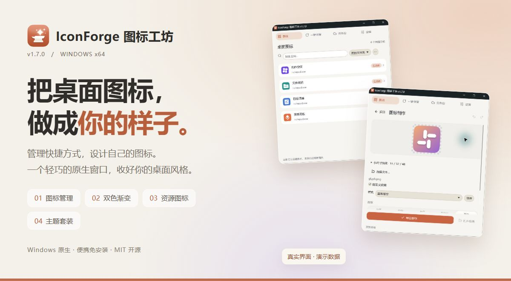
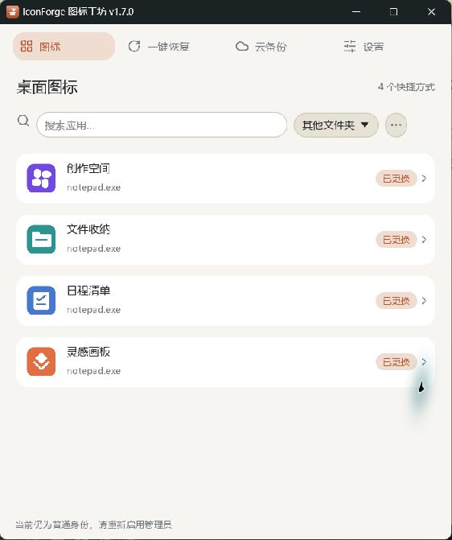
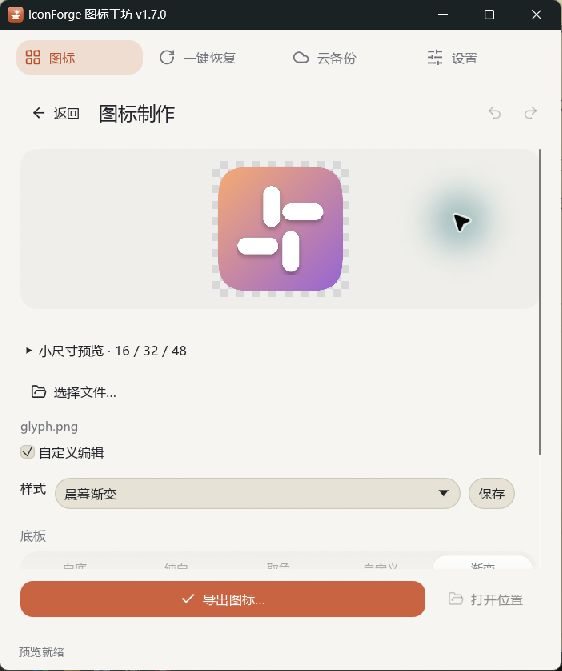
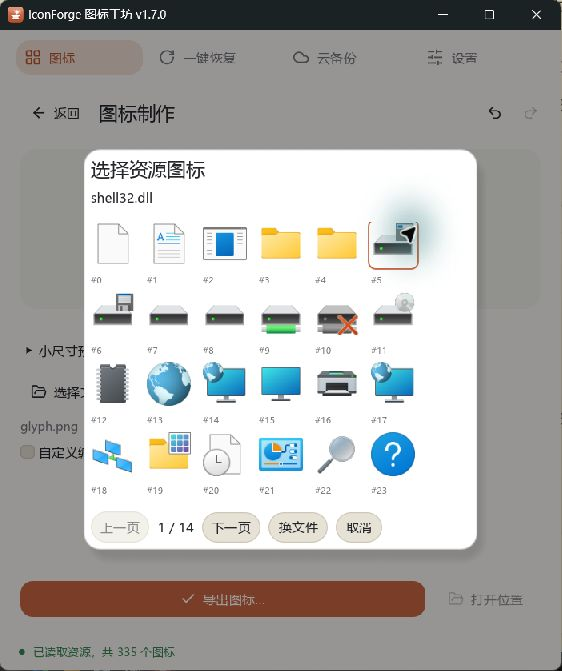

  

# IconForge 图标工坊

**管理快捷方式，设计自己的图标。**

Windows 原生小窗口 · 便携免安装 · MIT 开源

[**下载 Windows x64 版**](https://github.com/sym50/IconForge/releases/latest) · [版本记录](CHANGELOG.md) · [反馈问题](https://github.com/sym50/IconForge/issues)

## 能做什么

| 功能 | 介绍 |
| --- | --- |
| **快捷方式图标管理** | 读取桌面、开始菜单和指定文件夹，预览当前图标，再选择替换来源。 |
| **图标制作** | 调整底板、尺寸与圆角，使用双色渐变和方向角度，导出 PNG 或多尺寸 ICO。 |
| **程序资源图标** | 分页浏览 EXE / DLL 等文件中的图标，选中后复制为图片来源，继续编辑。 |
| **主题套装** | 把图标与样式保存为 `.iftheme` 套装；导入后先确认匹配，同名样式保留并自动编号。 |
| **编辑体验** | 撤销与重做、草稿记忆、16 / 32 / 48 像素预览、可关闭的透明棋盘格。 |
| **恢复与维护** | 原始快照、一键恢复、失效目标检测、快照占用统计和选择清理。 |
| **图标来源与备份** | 本地图片、iTunes 在线搜索、自备图标包，以及 WebDAV 手动备份与恢复。 |

## 界面预览

以下为 v1.7.0 实机截图，使用独立演示数据。

<table>
  <tr><th>快捷方式管理</th><th>图标制作与渐变</th><th>程序资源图标</th></tr>
  <tr>
    <td></td>
    <td></td>
    <td></td>
  </tr>
</table>

## 关于这个项目

IconForge 使用 Rust + egui 构建原生窗口。图标管理与制作功能参考了 [LinkEcho](https://github.com/iKineticate/LinkEcho)，在此基础上探索小窗口交互、原始快照保护和主题套装等体验。

在线搜索和 WebDAV 在主动使用这些功能时联网。WebDAV 密码使用 Windows DPAPI 在本机加密保存，不包含在云端备份中；跨电脑的快捷方式路径仍需对应处理。程序资源浏览只读提取图标，不修改 EXE / DLL 文件。

MiLan Pro 使用本机已安装字体，发行包未分发字体或第三方应用图标合集。截图中的演示图标仅用于展示。

当前版本 **v1.7.0**。已通过 **66 项测试**及 Windows release 构建验证。

## 开发与许可

开发构建见 [BUILDING.md](BUILDING.md)。主项目采用 [MIT 许可](LICENSE)，第三方声明见 [THIRD_PARTY_NOTICES.md](THIRD_PARTY_NOTICES.md)。感谢 LinkEcho 与 Lucide 项目。